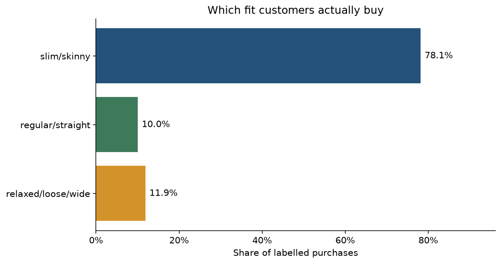
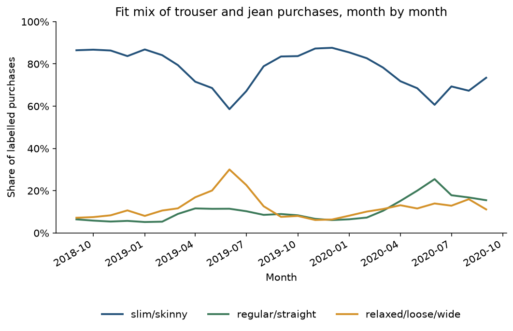
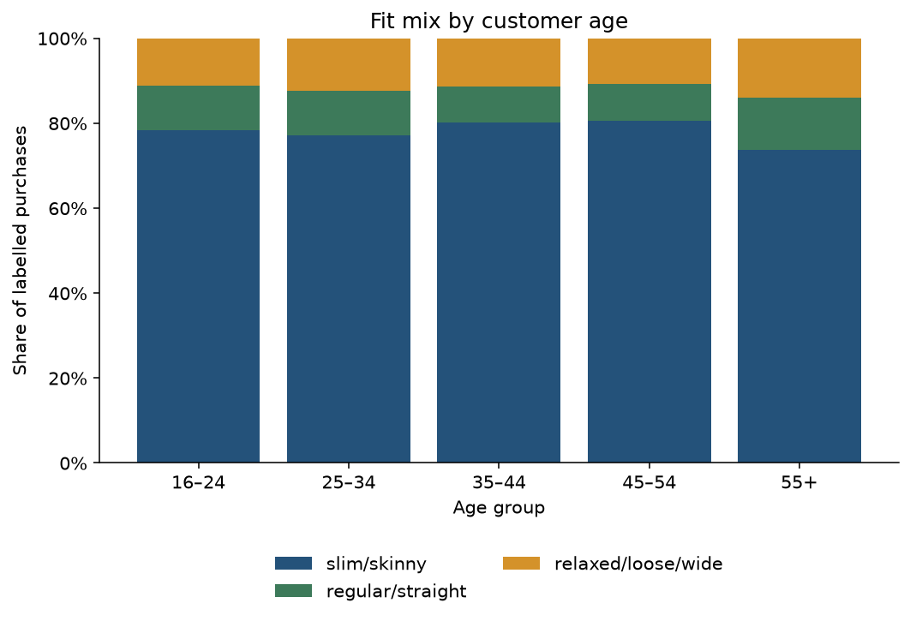
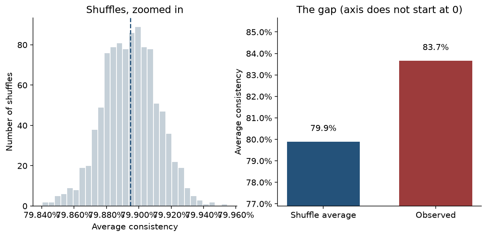

# Fit Signals

Can someone's trouser and jean purchases show which fit they prefer?

The H&M catalogue has no column for fit. The cut is written in the product name and the description: skinny, straight, relaxed, wide leg, high waist. We kept trousers and jeans, left out shorts, leggings and skirts, and labelled each product from those words. About two thirds of the products got a leg-fit label. "Oversized" never showed up. Waist (high, regular, low) was a second label, used so we could check the rules, not for the main test.

The transactions file is about 3.5 GB. The notebook reads it in chunks, keeps the date, the customer and the article, and saves the trouser and jean rows as a parquet file (about 26 MB, 3.7 million purchases, September 2018 to September 2020). The next run loads that file instead of scanning the csv again.

The question was whether people repeat a fit, or whether they only look consistent because the shop sells so much of one cut. Among labelled purchases, 78% are slim or skinny. Customers with at least five labelled purchases put 83.7% of those purchases into their single most common fit. We then shuffled the fit labels 1,000 times, so each person kept the same number of purchases but lost the link to a particular fit. The shuffled average is 79.9%, and the middle of those shuffles barely moves (79.86% to 79.93%). None of the 1,000 shuffles reached 83.7%.

The gap is 3.8 percentage points. Purchase history does carry a personal signal, and it is a small one. Most of the 83.7% is just the shop's mix. A later recommendation can lean toward the cut someone already repeats. It cannot stand in for a size chart.

Two other pictures, before that test. Over the 25 months, skinny stays the majority, but it swings from 59% (June 2019) to 88% (December 2019). By age the mix hardly changes; at 55 and older, skinny is 74% instead of about 80%. A chi-square test comes out tiny on the p-value only because there are millions of purchases. Cramer's V is 0.037, which is a small association, and the purchases are not independent rows.

The labels are keyword guesses. A third of the products have no fit word, and a text that says both slim and straight is called slim. Returns are not in the file, so a repeated purchase might be a pair that was sent back. The shuffle also ignores the month, and the monthly mix moves by up to 29 points, so some repetition is "they shopped when one fit was everywhere."









The left-hand panel of the last chart is zoomed in on the shuffles. The right-hand axis does not start at zero, otherwise a gap of a few points disappears. Both numbers are high.

## Data

[H&M Personalized Fashion Recommendations](https://www.kaggle.com/competitions/h-and-m-personalized-fashion-recommendations) on Kaggle. Put these three files in `data/`:

- `articles.csv`
- `customers.csv`
- `transactions_train.csv`

`data/` is gitignored, including the parquet file the notebook builds.

## Run it

```bash
python3.12 -m venv .venv
source .venv/bin/activate
pip install -r requirements.txt
python -m ipykernel install --user --name fit-signals --display-name "Python (fit-signals)"
jupyter notebook analysis.ipynb
```

Choose the kernel named Python (fit-signals) and run all cells. The first run scans the transactions file. Delete `data/trousers_transactions.parquet` if you change the product filter or the keyword rules and want that scan again.

The whole analysis is in `analysis.ipynb`. Each step has a short note on what it does and why, before the code.
